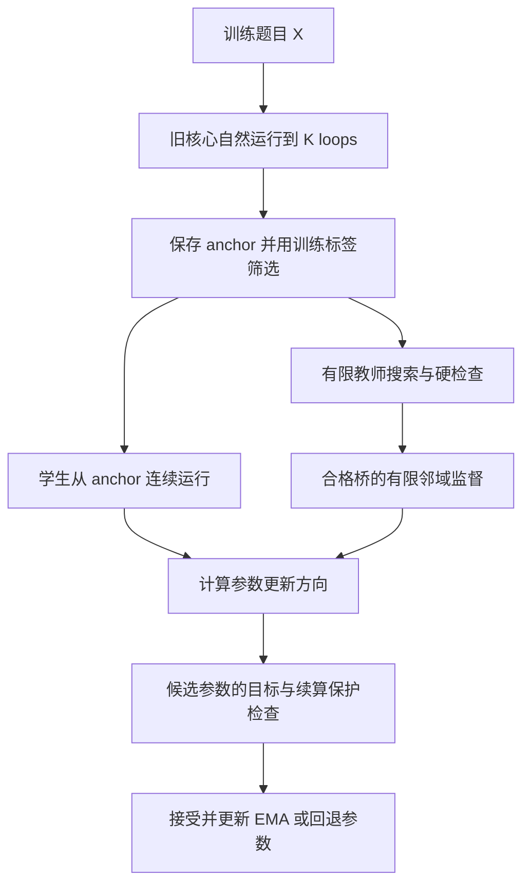

# SGRL-v2

SGRL-v2 在训练时寻找能够修复模型自身失败状态的隐藏路径，再把这些更新学进**同一个共享递归网络**。推理时只运行这个网络，不调用教师搜索、不读取答案，也不增加独立纠错网络。

本仓库基于 [官方 FPRM](https://github.com/nilskiKonjIzDunava/fprm) 的 `main` 分支，下载时提交为 `b291252387b2656d7a7bc2719d9317e6d812b283`。原版代码、许可及 [README_FPRM.md](README_FPRM.md) 保留；新方法使用独立的 [train_sgrl.py](train_sgrl.py)、[evaluate_sgrl.py](evaluate_sgrl.py) 和 [sgrl/](sgrl/) 模块。

这是研究方案的实现。当前没有 SGRL-v2 的 Sudoku、Maze、ARC-AGI-1 或 ARC-AGI-2 基准成绩；开发验证范围见 [docs/validation.md](docs/validation.md)。历史 RNC-FPRM 候选 A 的成绩不属于本方法。方法定义来源于此前讨论，完整参考见 [docs/method_reference.md](docs/method_reference.md)。

## 方法动机与整体流程

共享递归模型使用同一组参数反复更新隐藏状态：

$$z_{t+1}=T_\theta(z_t;x),\qquad x=E(X),\qquad \hat y_t=\arg\max D(z_t).$$

假设模型自然到达一个当前答错、在指定末端窗口仍答错的状态 $a$。训练时尝试寻找：

$$a=q_0\to q_1\to\cdots\to q_m=w_0\to w_1\to\cdots,$$

前半段是待学习的修复桥，后半段必须由冻结的旧网络真实执行：$w_{k+1}=T_{\bar\theta}(w_k;x)$。桥端点交给旧网络后，需要在指定末端窗口保持正确。桥的中间读出可以暂时变差。

只模仿几个隐藏点容易出现三类问题：相近状态被要求产生不一致后继，学生偏离教师路径后误差累积，以及更新共享参数时破坏教师赖以成立的后续计算。本方法分别使用分离的状态邻域、带收缩偏差的邻域目标、更新后保护检查处理这些问题。



## 相比原版 FPRM 改了什么

| 项目 | 上游 FPRM Sudoku 配置 | 本实现 SGRL-v2 |
|---|---|---|
| 共享核心 | 两层 Transformer，输入反复注入 | 复用其 Attention、SwiGLU 和残差系数 |
| 卷积与归一化 | 默认二维卷积、pre-RMSNorm | 无卷积、pre-RMSNorm、无额外输出归一化 |
| 外层更新 | FPOPT 残差、步长衰减与停止控制 | 直接更新隐藏状态，固定 $K$ 次 loop |
| 训练自产状态 | 已有跨监督段携带与 detach | 额外按规定预算筛选自然失败状态 |
| 监督 | 任务监督、分段反传 | 学生真实续算 + 合格修复桥的邻域监督 |
| 恢复阶段参数 | 原版通常联合训练 | 冻结输入编码器、题目嵌入和输出头，仅更新共享核心 |
| 更新验收 | 原版优化器更新 | 梯度下降提议、更新后检查、回溯 |
| 推理附加部件 | 原版停止相关部件 | 无教师搜索、独立修复器或 Q/ACT 头 |

因此，本方法同时改变了训练方式、卷积和外层迭代协议。不能直接继承 FPOPT 的收敛结论，也不能把效果差异全部归因于“修复学习”。需要同结构、同预算的普通训练对照。

核心来自 [models/transformer.py](models/transformer.py)，SGRL 约束在 [sgrl/model.py](sgrl/model.py)。两个 block 展开为四个 attention/SwiGLU 子层：

$$h^0=\alpha_2\odot z+\beta_2\odot x,$$
$$h^\ell=\alpha_1\odot h^{\ell-1}+\beta_1\odot f_{\theta,\ell}(\operatorname{RMSNorm}(h^{\ell-1})),\quad \ell=1,\ldots,4,$$
$$\alpha_i=\operatorname{sigmoid}(a_i),\quad \beta_2=1-\alpha_2\odot\alpha_1^4,\quad \beta_1=\frac{\beta_2\odot(1-\alpha_1)}{1-\alpha_1^4+10^{-5}}.$$

一次 loop 是整个两层共享核心的一次调用，不是一次 optimizer step，也不是单个 Transformer block。

## 1. 失败状态如何得到

训练批次开始时固定当前核心快照 $\bar\theta$。从不含标签的初始化 $z_0$ 自然运行到总预算 $K$；每批在配置范围均匀抽取一个深度 $t$，保存状态 $a=T_{\bar\theta}^{t}(z_0;x)$。

标签只用于判断预测，不参与自然状态生成。令 $S$ 为末端窗口跨度，观察 $S+1$ 个时刻 $K-S,\ldots,K$。从 anchor 看，它们对应续算索引 $H,\ldots,H+S$，其中 $H=K-t-S$。

教师搜索候选须同时满足：anchor 的整题预测错误；末端窗口每次整题预测都错误；样本至少含一个有效标签位置，排除 padding 行。

例如 $K=100$、$S=2$、$t=40$：

| 保存的候选状态 | 第 98 loop | 第 99 loop | 第 100 loop | 是否进入这一类修复候选 |
|---|---|---|---|---|
| 第 40 loop，错误 | 错 | 错 | 错 | 进入 |
| 第 40 loop，错误 | 错 | 对 | 对 | 不进入 |
| 第 40 loop，正确 | 错 | 错 | 错 | 不进入，属于正确后退化 |

**这不表示第 41–97 loop 全都错误。** 中间短暂正确、末端又全部错误的轨迹仍可能入选。筛选条件是“anchor 错误且末端窗口全部错误”，不是“所有后续时刻从未正确”，更不是证明永久错误吸引子。

每批最多随机挑选 `max_anchors` 个候选搜索教师，以限制成本。正确样本、未被选中搜索的样本、教师搜索失败的样本，都继续参与真实任务损失。当前没有跨批累积的 replay pool，更新后重新收集。代码入口：`collect_failures`，见 [sgrl/recovery.py](sgrl/recovery.py)。

## 2. 教师搜索：修复桥连接有效续算

冻结编码器、输出头与旧核心，只优化隐藏路径变量 $v,U_j$：

$$q_j=a+\frac{j}{m}v+P_vU_j,\quad U_0=U_m=0,$$
$$P_vU=U-v\frac{\langle v,U\rangle_M}{\|v\|_M^2}.$$

$\|\cdot\|_M$ 是有效位置和隐藏坐标上的均方根范数；有效位置包括有标签的输出位置及非空样本的题目寄存器。扰动在其他位置置零。横向弯曲与总体位移正交，给不同桥阶段提供分离依据。

桥长度 $m\le H$；真实后续计算长度为 $L_s=K-t-m$。教师目标是：

$$\mathcal J_Q=\frac1{S+1}\sum_{s=0}^S\ell(D(w_{H-m+s}),y)
+\frac{\lambda}{m}\sum_{j=0}^{m-1}\|q_{j+1}-T_{\bar\theta}(q_j;x)\|_M^2
+\nu\mathcal P_{\mathrm{clear}}.$$

三项分别要求末端任务表现、限制桥偏离旧更新的程度、鼓励邻域间距。随机起点、优化次数、最大位移均有明确预算，搜索不保证成功。

教师必须通过硬检查：几何间距满足要求；末端损失优于原续算；末端窗口整题正确且具有正分类 margin；从受扰动入口真实续算仍满足末端条件；沿后续路径的有限探针满足一步敏感度阈值。低惩罚值不等于通过这些检查。

**冻结参数不等于 `no_grad()`。** 教师搜索保留旧核心对输入状态的梯度，才能优化 $v,U_j$。搜索结束后，教师状态和扰动点全部 detach，不穿过教师优化器求超梯度。

## 3. 邻域目标与学生真实续算

桥点 $q_j$（$j=0,\ldots,m-1$）周围使用半径 $r_B$ 的邻域，后续路径 $w_k$ 使用半径 $r_S\ge r_B$ 的邻域。桥域之间、桥域与后续路径域之间检查间距。**$q_m=w_0$ 只属于后续路径域**，不要求它与自身分离。

对于偏离教师点的状态 $q_j+\delta$，目标为：

$$T_\theta(q_j+\delta;x)\approx q_{j+1}+\kappa\delta,\qquad 0\le\kappa<1.$$

这既前进到下一阶段，又缩小路径偏差。部署网络只接收 $x,z$，不接收阶段编号或教师点。

训练用有限随机起点和投影梯度上升构造探针集合 $\mathcal A_j$，并包含中心：

$$\widehat{\mathcal L}_B=\sum_{j=0}^{m-1}\max_{\delta\in\mathcal A_j}
\|T_\theta(q_j+\delta;x)-(q_{j+1}+\kappa\delta)\|_M^2.$$

同时，学生必须从原自然 anchor 连续自由运行：

$$u_0=\operatorname{stopgrad}(a),\quad u_{k+1}=T_\theta(u_k;x),$$
$$\mathcal L_{\mathrm{real}}=\frac1{S+1}\sum_{s=0}^S\ell(D(u_{H+s}),y),$$
$$\mathcal L_{\mathrm{proposal}}=\mathcal L_{\mathrm{real}}+\beta_B\mathbf1[\text{合格教师}]\widehat{\mathcal L}_B.$$

真实学生轨迹中不插入教师状态。代码按有效样本数平均，未获得教师的样本桥损失为零，任务损失仍存在。anchor 前的收集无梯度；anchor 后的学生 rollout 完整反传。Activation checkpointing 只重算激活，不截断这段梯度。

## 4. 更新后的保护与回溯

共享核心同时承担修复和有效续算。计算一个梯度方向后，依次尝试：

$$\theta_b=\bar\theta-\alpha_0\rho^b\nabla\mathcal L_{\mathrm{proposal}},\qquad 0<\rho<1.$$

在同一批固定后续路径探针上检查：

$$\|T_{\theta_b}(w_k+\delta;x)-T_{\bar\theta}(w_k+\delta;x)\|_M\le\bar\epsilon_S.$$

本实现还要求同一组桥探针、同一批 anchor 上的候选总目标下降，且真实任务损失不增加超过 `real_loss_slack`（默认零）。接受第一个通过的步长；全部失败则恢复原参数。没有合格教师时，保护集合为空，但真实任务损失仍接受回溯检查。

恢复阶段采用无动量梯度下降，与方案更新式一致。EMA 仅在参数更新被接受后推进。被拒候选的结果使用 `candidate_` 指标前缀，不冒充最终模型成绩。

这些是有限探针保护，不保证所有已解样本永不退化；正确样本仍参与任务监督，评测额外统计正确变错。

## 5. 理论支持到哪里

若学生在整个桥邻域内的目标误差都不超过 $\epsilon_B$，则路径偏差满足：

$$E_{j+1}\le\kappa E_j+\epsilon_B,\quad E_0=0,\qquad
E_j\le\epsilon_B\frac{1-\kappa^j}{1-\kappa}.$$

后续计算还需要局部 Lipschitz 常数、更新偏移和分类 margin 的条件，才可得到有限步正确性结论。有限探针不是整个邻域统一误差的证明。

待验证的问题包括教师覆盖率、邻域目标的可学习性、新参数自然轨迹与旧 anchor 的分布变化，以及收益能否胜过同训练 FLOPs、同监督信息的普通训练。状态恢复也不自动解决 ARC 的规则发现。本仓库实现 puzzle 模型，不含方法讨论中的因果语言模型 KV 分支。

## 运行 SGRL-v2

依赖沿用上游 [pyproject.toml](pyproject.toml)，可以使用 `uv sync` 或已有 Python 环境：

```bash
git clone https://github.com/OceansStill/SGRL-v2.git
cd SGRL-v2
uv sync
source .venv/bin/activate
```

在 Slurm 集群上，GPU 训练应在已经获得资源分配的计算节点运行；下面的命令不申请 GPU。SGRL 入口目前支持单进程单设备，不接受多 rank `torchrun`。

数据仍使用上游格式，构建命令见下方原版说明。已有数据可通过 `data_path=/absolute/path/to/dataset` 复用。ARC-AGI-1/2 使用 [build_arc_dataset.py](dataset/build_arc_dataset.py) 分别生成目录，并保持训练/测试分配和题目标识映射。

### 先训练基础模型

恢复阶段需要已有基础模型，不能冻结随机编码器和随机输出头后把训练视为有效恢复。先在同一固定 loop 结构上做普通任务训练：

```bash
python train_sgrl.py --config config/sgrl/sudoku.yaml --dry-run
python train_sgrl.py --config config/sgrl/sudoku.yaml
```

基础阶段联合训练编码器、输出头、核心；稠密参数采用 AdamW，题目嵌入沿用上游稀疏 SignSGD。损失取固定预算的末端窗口，不复刻原版六步监督段。`steps` 是训练批次数，**不等于原版 FPRM 配置中的 epochs**。

### 恢复训练

```bash
python train_sgrl.py --config config/sgrl/sudoku.yaml \
  stage=recovery init_from=runs/sgrl-sudoku-base/latest.pt init_weights=ema \
  output_dir=runs/sgrl-sudoku-recovery
```

恢复入口要求 `init_from` 或 `resume`，校验 checkpoint 配置。当前接受本仓库 SGRL checkpoint，不自动把含卷积/FPOPT 的原版权重当作结构等价模型。

另有 [Maze](config/sgrl/maze.yaml)、[ARC-AGI-1](config/sgrl/arc1.yaml)、[ARC-AGI-2](config/sgrl/arc2.yaml) 配置。它们是未调参的开发起点，不是性能或显存承诺。默认 float32；可配置 `model.forward_dtype=bfloat16`，但量化误差对严格邻域、margin 与回溯验收的影响需另行验证。

| 参数 | 含义 | Sudoku 开发默认 |
|---|---|---|
| `recovery.loops` | 总训练预算 $K$ | 72 |
| `recovery.terminal_window` | 跨度 $S$，实际检查 $S+1$ 次 | 2 |
| `recovery.anchor_min/max` | 每批 anchor 深度范围 | 12 / 36 |
| `recovery.bridge_steps` | 桥长度 $m$ | 4 |
| `recovery.max_anchors` | 每批最多搜索教师的样本数 | 2 |
| `recovery.teacher_restarts/steps` | 随机起点 / 每次优化步数 | 2 / 16 |
| `recovery.probes` | 扰动起点数，另加中心 | 2 |
| `recovery.backtrack_attempts` | 候选参数最多尝试次数 | 8 |
| `batch_size` | 单设备样本数 | 8 |
| `save_every` | 保存间隔，单位批次 | 100 |
| `eval_every` | 训练内评测间隔；0 表示独立评测 | 0 |

全部字段与预算检查见 [sgrl/config.py](sgrl/config.py)。教师搜索、探针、后缀反传和候选更新检查会增加训练成本，不能沿用原版 batch=768 的显存估计。

### Checkpoint 与恢复

`step_XXXXXXXX.pt` 保存原始参数、EMA、基础阶段优化器、配置、已接受更新数、Python/NumPy/Torch RNG 和采样游标；`latest.pt` 指向最近保存文件。先保存，再进行耗时的 EMA 评测。

```bash
python train_sgrl.py --config config/sgrl/sudoku.yaml \
  stage=recovery resume=runs/sgrl-sudoku-recovery/latest.pt \
  output_dir=runs/sgrl-sudoku-recovery steps=20000
```

恢复要求 recipe、batch、数据与模型配置一致。采样器重放当前采样块定位游标，不重跑模型；数据必须保持不变。不同硬件/算子下不承诺逐位复现。`init_from` 是新实验初始化，不恢复优化器和数据进度。

### 配对 EMA 评测

```bash
python evaluate_sgrl.py \
  --checkpoint runs/sgrl-sudoku-recovery/latest.pt --weights ema \
  --data-path data/sudoku-extreme-1k-aug-1000 \
  --loops 1000 35000 --batch-size 8 \
  --output results/sudoku-ema-1000-35000.json
```

到较小上限时保存解码结果，携带同一个隐藏状态继续，不重置轨迹。固定 loop 推理不会冻结已经正确的样本，因此正确后变错可能大于零。输出含每个上限的整题/格子正确率，以及 `correct_correct`、`correct_wrong`、`wrong_correct`、`wrong_wrong` 配对表。

默认遍历完整测试集；开发时可显式加 `--max-batches 10`，输出记录限制，部分样本结果不能当作全量成绩。ARC 加 `--arc-voting` 可运行上游反增强、裁剪、投票和 pass@K；SGRL 无 Q 头，置信度使用常数，平分处理不与原版 learned-Q 完全相同。token 整题正确率不等于 ARC 汇总分数。

## 文件与验证

| 文件 | 职责 |
|---|---|
| [sgrl/model.py](sgrl/model.py) | 共享核心、输入/读出、冻结边界 |
| [sgrl/recovery.py](sgrl/recovery.py) | 失败采集、教师、探针、学生损失与回溯 |
| [sgrl/objectives.py](sgrl/objectives.py) | 掩码损失、整题判断、margin 与状态度量 |
| [sgrl/data.py](sgrl/data.py) | 数据适配和可恢复采样游标 |
| [sgrl/checkpoint.py](sgrl/checkpoint.py) | 参数、EMA、优化器、RNG 与原子保存 |
| [sgrl/evaluation.py](sgrl/evaluation.py) | 同轨迹多上限评测 |
| [tests/test_sgrl.py](tests/test_sgrl.py) | CPU 回归验证 |

```bash
CUDA_VISIBLE_DEVICES="" TORCHDYNAMO_DISABLE=1 OMP_NUM_THREADS=1 \
  python -m unittest discover -s tests -v
```

单元验证检查实现行为，不能建立任务精度、GPU 显存或吞吐结论。效果实验需包含同结构普通训练、只增加 anchor 续算监督、点路径模仿、去掉更新后保护，以及匹配教师成本的常规训练对照。方法来源是用户提供的 [分享对话](https://chatgpt.com/share/6afa02f2-6414-83ec-ab9d-c383545b3714)，属于研究设计记录。

---

# FPRM 原始说明

以下保留上游使用说明供对照；其中 `pretrain.py` 运行原版 FPRM。SGRL-v2 请使用上面的 `train_sgrl.py`。

This code accompanies the paper:\
\[[Fixed-Point Reasoners: Stable and Adaptive Deep Looped Transformers](https://arxiv.org/abs/2606.18206)\]

<p align="center">
  
  <br>
  <em>FPRM vs. TRM on Sudoku-Extreme: despite being non-hierarchical, FPRM scales better with compute and halts at the right point via fixed-points.</em>
</p>

## Installation

Requirements: Linux with an NVIDIA GPU (CUDA 12.x driver) and Python 3.11–3.12. Dependencies are managed with [uv](https://docs.astral.sh/uv/).

```bash
git clone https://github.com/nilskiKonjIzDunava/fprm.git
cd fprm
uv sync
```

`uv sync` creates a project-local `.venv/` and installs everything (PyTorch is pulled from the CUDA 12.9 wheel index). Run commands either via `uv run <cmd>` or after `source .venv/bin/activate` — always from the repository root.

Training logs to Weights & Biases: run `wandb login` first, or set `WANDB_MODE=offline` to disable.

## Usage

### 1. Build the datasets

Datasets are not shipped; build them into `data/` first. Sudoku and Maze download automatically from the Hugging Face Hub:

```bash
# Sudoku-Extreme: 1000 puzzles x 1000 augmentations
uv run python dataset/build_sudoku_dataset.py \
    --output-dir data/sudoku-extreme-1k-aug-1000 --subsample-size 1000 --num-aug 1000

# Maze-Hard 30x30: non-augmented (the default; the 8x augmented build collapses to ~5%)
uv run python dataset/build_maze_dataset.py \
    --output-dir data/maze-30x30-hard-1k-noaug

# State-tracking: generated locally from the permutation group (no download).
# A5 (alternating group) and S5 (symmetric group), 2M training sequences each,
# trained at length 32 and evaluated on prefixes up to 128.
uv run python dataset/build_state_tracking_dataset.py \
    --group A5 --k-train 32 --k-eval-max 128 --train-samples 2000000 \
    --output-dir data/state_tracking-A5-train32-eval128-2M

uv run python dataset/build_state_tracking_dataset.py \
    --group S5 --k-train 32 --k-eval-max 128 --train-samples 2000000 \
    --output-dir data/state_tracking-S5-train32-eval128-2M
```

### 2. Train

`pretrain.py` is the (Hydra) training entrypoint; the reproduced experiment configs live in `config/`. `arch=fprm` is the paper's model; `trm`, `trm_singlez`, `trm_hier6`, `hrm`, and `transformers_baseline` are also available. `global_batch_size=768` is fixed regardless of GPU count, so results match across these configurations. Sudoku trains on a single GPU as shown below. Maze on multiple GPUs. For the multi-seed runs, set `seed=0`, `seed=1`, `seed=2`.

#### Single-GPU (Sudoku)

The Sudoku config uses `n_backwards_L=6` for 81 tokens per sequence, which fits in a single 40 GB GPU at `global_batch_size=768`. So you can train it without `torchrun`:

```bash
uv run python pretrain.py --config-name cfg_pretrain_sudoku
```

Any field can be overridden on the command line — e.g. the seed and W&B naming:

```bash
uv run python pretrain.py --config-name cfg_pretrain_sudoku \
    seed=1 +project_name=fprm-sudoku +run_name=my-run +checkpoint_path=checkpoints/my-run
```

#### Multi-GPU (Maze)

The Maze config uses `n_backwards_L=6` for 900 tokens per sequence, which exceeds a single 40 GB GPU at `global_batch_size=768`. Train it across multiple GPUs with `torchrun` — e.g. 4× A100-80GB on one node, or 8× A100-40GB across two:

```bash
# 1 node, 4 GPUs
torchrun --standalone --nproc-per-node=4 \
    pretrain.py --config-name cfg_pretrain_maze

# 2 nodes x 4 GPUs (one torchrun per node; HEAD_NODE = rank-0 hostname)
torchrun --nnodes=2 --nproc-per-node=4 \
    --rdzv-backend=c10d --rdzv-endpoint="$HEAD_NODE:29850" \
    pretrain.py --config-name cfg_pretrain_maze
```

#### Single-GPU (State tracking)

State tracking has one config per group — `cfg_pretrain_state_tracking_fprm_a5`
(alternating group A5) and `cfg_pretrain_state_tracking_fprm_s5` (symmetric group
S5). Both are small (hidden 512, 2 L-layers, causal attention, no puzzle embedding,
no positional encoding) and train on a single 40 GB GPU at `global_batch_size=1024`:

```bash
# A5
uv run python pretrain.py --config-name cfg_pretrain_state_tracking_fprm_a5

# S5
uv run python pretrain.py --config-name cfg_pretrain_state_tracking_fprm_s5
```

The two configs are identical except for the group-specific settings baked in:
`data_paths`, `arch.decay_patience` (A5: 5, S5: 10), and `arch.stepsize_decay_train`
(A5: 0.90, S5: 0.95). As above, override the seed and W&B bookkeeping on the command
line for multi-seed runs:

```bash
uv run python pretrain.py --config-name cfg_pretrain_state_tracking_fprm_s5 \
    seed=1 +project_name=fprm-state-tracking +run_name=my-run +checkpoint_path=checkpoints/my-run
```

## Citation

```bibtex
@misc{movahedi2026fixedpointreasonersstableadaptive,
      title={Fixed-Point Reasoners: Stable and Adaptive Deep Looped Transformers}, 
      author={Sajad Movahedi and Vera Milovanović and Shlomo Libo Feigin and Alexander Theus and Thomas Hofmann and Valentina Boeva and T. Konstantin Rusch and Antonio Orvieto},
      year={2026},
      eprint={2606.18206},
      archivePrefix={arXiv},
      primaryClass={cs.AI},
      url={https://arxiv.org/abs/2606.18206}, 
}
```

## Acknowledgments

The puzzle tasks built on [TRM](https://github.com/SamsungSAILMontreal/TinyRecursiveModels) and state-tracking on [FP-RNN](https://github.com/dr-faustus/fp-rnn)
